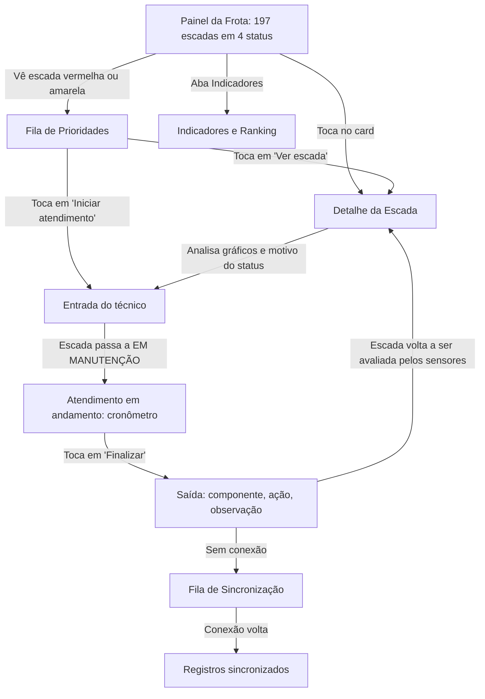

# PRD (Product Requirements Document) — Protótipo / MVP Navegável

**Elevate — Tablet de Manutenção Orientada por Condição para as Escadas Rolantes da Linha 4 (Motiva / ViaQuatro)**

---

## 1. Capa e Metadados

* **Nome do Produto:** Elevate
* **Squad:** Elevate — Challenge Motiva + FIAP 2026/2027
* **Integrantes:** Artur Henrique Siqueira (RM 566986), Davi de Souza Malta (RM 560327), Guilherme Cruz Alves (RM 566861), Guilherme de Oliveira Scremin (RM 564788), Pedro Sales Ferreira (RM 566910)
* **Versão do PRD:** 1.0 (Protótipo Navegável / MVP)
* **Data:** 16 de outubro de 2026
* **Fontes de referência:**
  * Enunciado do Challenge (Motiva + FIAP, "Escadas Rolantes: Manutenção Orientada por Dados")
  * Plano de Manutenção Preventiva PMP-6ECR-0001 rev. 12 e roteiros RMP-6ECR (Linha 4)
  * Histórico SAP de manutenção das escadas (nov/2009 a set/2026), analisado no Dossiê ECR Linha 4
  * Dataset simulado de sensores do grupo (197 escadas, 90 dias, 5 leituras por dia) e a análise exploratória em notebook
* **Formato de entrega do artefato:** um único arquivo `index.html`, autocontido, que abre **sem internet** (bibliotecas e dados embutidos no próprio arquivo), pensado para rodar no navegador de um tablet com Raspberry Pi.

---

## 2. Sumário Executivo

### 2.1 Declaração do Problema

A ViaQuatro mantém 197 escadas rolantes em 12 locais da Linha 4-Amarela. A manutenção segue um plano preventivo por calendário (P1 mensal, P6, P9, P12, P18, P36 e P72), igual para escadas com usos muito diferentes. Isso gera três problemas:

1. **Os dados dos sensores não são guardados.** A equipe não tem histórico de vibração, temperatura, corrente, óleo ou velocidade para perceber um desgaste se formando.
2. **A falha é descoberta quando a escada já parou.** O histórico real mostra paradas que ficam meses sem solução (ex.: escadas ESCAL de Pinheiros entre nov/2025 e jan/2026) e picos de falha nos horários de maior fluxo (18h e 7h–8h).
3. **O registro do atendimento é pouco estruturado.** Não há controle simples de quando o técnico começou e terminou cada manutenção, nem de quanto tempo a escada ficou parada por causa dela.

### 2.2 Visão do Produto

> **Para** os técnicos e a engenharia de manutenção da Linha 4, **que** precisam saber onde agir primeiro, **o Elevate é** um tablet com Raspberry Pi e um dashboard que mostra o status de cada escada a partir dos sensores e registra o início e o fim de cada atendimento. **Diferente** da manutenção só por calendário, ele prioriza pela condição real do equipamento e **funciona mesmo sem Wi-Fi** dentro das estações.

Frase de apoio: *"Elevate: elevating maintenance to the next level."*

### 2.3 Resultados esperados (hipóteses a validar)

Os números abaixo vêm do dataset simulado e servem para dimensionar o protótipo. Eles precisam ser confirmados com dados reais da Motiva:

* **Antecedência:** nas sequências que terminam em CRÍTICO, o ALERTA aparece em mediana **2,4 dias antes**. É o tempo que o Elevate dá para a equipe agir antes da falha.
* **Concentração:** 10 escadas passam de 14% a 21% do tempo em ALERTA ou CRÍTICO, então priorizar bem tem efeito grande.
* **Paradas curtas:** a maior parte dos CRÍTICOS são paradas de segurança resolvidas com reset (mediana de 28 minutos). Separar esse motivo evita mobilizar a equipe errada.

---

## 3. Objetivo do Protótipo

Validar com a gerência de manutenção, a engenharia e os técnicos de campo as seguintes hipóteses:

1. **H1 — Leitura rápida:** um painel com 4 status (BOM, ALERTA, CRÍTICO, EM MANUTENÇÃO) permite ao técnico saber em menos de 10 segundos quais escadas exigem ação.
2. **H2 — Priorização:** uma fila ordenada por status, grupo da escada (crítica ou não crítica) e tempo no status atual organiza melhor o turno do que a lista do calendário.
3. **H3 — Registro de atendimento:** registrar entrada e saída no tablet, com componente e ação obrigatórios, é viável na rotina do técnico e gera o tempo de manutenção automaticamente.
4. **H4 — Operação sem rede:** o tablet continua útil sem Wi-Fi, guardando os registros e sincronizando quando a conexão volta.
5. **H5 — Menos alarme falso:** exigir duas leituras seguidas fora do limite antes de marcar CRÍTICO por limite evita alertas causados por leituras espúrias do sensor.

---

## 4. Escopo do Protótipo

### 4.1 Dentro do Escopo (IN)

* As **197 escadas e 12 locais** do dataset simulado, com fabricante (Thyssen ou ESCAL) e grupo (crítica ou não crítica).
* **Reprodução da telemetria** das 5 leituras diárias de 01/07 a 28/09/2026, com relógio de simulação (play, pausa, velocidade e salto para uma data).
* **Status calculado no próprio protótipo** a partir das leituras e dos atendimentos (seção 9).
* Gráficos das **6 variáveis** com as linhas de ALERTA e CRÍTICO.
* **Fila de prioridades** com política de despacho.
* **Fluxo de atendimento:** entrada do técnico (a escada vai para EM MANUTENÇÃO), cronômetro, saída com componente, ação e observação.
* **Indicadores:** disponibilidade, tempo médio de reparo, tempo de resposta, antecedência ALERTA → CRÍTICO, paradas de segurança, preventiva P1 em dia e ranking.
* **Modo sem conexão** simulado, com fila de sincronização.

### 4.2 Fora do Escopo (OUT)

* Integração real com sensores, CLP, Raspberry Pi físico, MQTT ou banco de dados de servidor.
* Integração com o SAP da ViaQuatro.
* Modelos de Machine Learning para prever a data exata da falha (o protótipo usa limites fixos).
* **Comandos para a escada** (ligar, desligar, reset remoto). O sistema é só consultivo.
* Itens que a Motiva definiu como fora do escopo atual: **trincas estruturais, estado do corrimão, condição do freio e roletes danificados**.
* Elevadores e esteiras rolantes.
* Login e perfis de acesso reais (o protótipo usa um seletor de técnico).

---

## 5. Personas e Casos de Uso

| Persona | Perfil e dores | Tela principal | Decisão que toma no protótipo |
| :---- | :---- | :---- | :---- |
| **Marcos Lima** *(41 anos, técnico de manutenção)* | Atende chamados e faz a P1 mensal (2 h por escada). Hoje só descobre o problema quando a escada para, muitas vezes no pico. Resolve muitas paradas só com reset e não tem histórico para entender a repetição. | Fila de Prioridades e Atendimento | Escolhe a próxima escada, dá entrada no tablet, consulta os gráficos para entender o defeito e dá saída informando componente e ação. |
| **Juliana Alves** *(35 anos, engenheira de manutenção)* | Escreve o plano preventivo e a classificação de escadas críticas e não críticas. Não tem dados de desgaste para justificar mudar a periodicidade. | Detalhe da Escada e Indicadores | Identifica escadas com degradação recorrente, compara ESCAL × Thyssen e propõe ajustes de limite e de plano. |
| **Ricardo Souza** *(47 anos, supervisor do Centro de Controle)* | Precisa decidir se libera ou mantém uma escada desligada e responder pela disponibilidade da linha. | Painel da Frota | Acompanha quantas escadas estão em cada status, recebe as notificações imediatas e cobra o tempo de resposta. |
| **Passageiro** *(beneficiário indireto)* | Sofre com escada parada no horário de pico. | — | Não usa o sistema; é quem ganha com menos paradas no pico. |

---

## 6. Jornada do Usuário no Protótipo

1. **Triagem:** o técnico abre o Painel da Frota e vê os contadores dos 4 status. Um banner avisa se há notificação imediata.
2. **Priorização:** na Fila de Prioridades, a escada `PIN-ER13` (grupo crítica) aparece no topo com CRÍTICO por vibração, despacho **Imediato**.
3. **Diagnóstico:** no Detalhe da Escada, o gráfico mostra a vibração subindo por dias até passar de 7,1 mm/s, depois de semanas em ALERTA.
4. **Entrada:** o técnico toca em "Iniciar atendimento". A escada vai para EM MANUTENÇÃO e o cronômetro começa.
5. **Saída:** ao terminar, toca em "Finalizar", escolhe o componente (ex.: "Rolamento do redutor"), a ação ("Substituído") e escreve uma observação. O tempo de manutenção é calculado sozinho.
6. **Sem rede:** se o tablet estiver sem conexão, o registro fica "Pendente" na Fila de Sincronização e é enviado quando a rede volta.

---

## 7. Mapa de Telas

Aplicação de página única, com navegação por abas fixas na lateral (modo paisagem do tablet) ou na base (modo retrato).

### Tela 1: Painel da Frota

* **Propósito:** mostrar em segundos a situação das 197 escadas.
* **Blocos de interface:**
  * `[Barra superior]` Logo Elevate, data e hora da simulação, controles (play/pausa/velocidade/ir para data), seletor do técnico logado, **indicador de conexão** (Online / Sem conexão, com o horário da última sincronização) e contador de registros pendentes.
  * `[Contadores]` 4 cartões grandes: BOM (verde), ALERTA (amarelo), CRÍTICO (vermelho), EM MANUTENÇÃO (azul), cada um com ícone e texto, e não só cor.
  * `[Banner de notificação]` Aparece quando há CRÍTICO em escada do grupo crítica, com botão "Ver na fila".
  * `[Filtros]` Estação (12 locais), status, grupo (crítica/não crítica), fabricante (Thyssen/ESCAL) e busca por código (ex.: `PIN-ER25`).
  * `[Grade]` Escadas agrupadas por estação. Cada card mostra código, status (cor, ícone e palavra), motivo resumido ("Vibração 7,4 mm/s", "Sem resposta do sensor", "Parada", "Em manutenção há 1 h 20"), selo de grupo e mini-barra do nível de óleo.
* **Dados:** `escadas[]`, leitura atual de cada escada (na data da simulação), `atendimentos[]` em aberto.
* **Regras ativas:** RN-01 (status), RN-02 (confirmação), RN-04 (notificação).
* **Ações:** filtrar, buscar, tocar no card (abre a Tela 2) e tocar no banner (abre a Tela 3).
* **Critérios de aceite:** os contadores batem com a grade filtrada; ao avançar o relógio, cards e contadores se atualizam sem recarregar a página.

### Tela 2: Detalhe da Escada

* **Propósito:** dar ao técnico e à engenharia o histórico e o motivo do status para decidir a ação.
* **Blocos de interface:**
  * `[Cabeçalho]` Código, estação, fabricante, grupo, status atual com motivo e há quanto tempo está nesse status.
  * `[Cartões das variáveis]` Valor atual das 6 variáveis com cor do limite (vibração, temperatura, corrente, tensão, velocidade, óleo).
  * `[Gráficos]` Uma série temporal por variável, com período ajustável (7, 30 ou 90 dias), linhas tracejadas de ALERTA e CRÍTICO, faixas de manutenção sombreadas em azul e marcadores nas leituras sem sinal.
  * `[Preventiva P1]` Data da última P1 e dias desde então; fica vermelho acima de 30 dias (obrigação legal).
  * `[Histórico de atendimentos]` Tabela: entrada, saída, duração, tipo (preventiva/corretiva), motivo, componente, ação, técnico.
  * `[Ação principal]` Botão grande "Iniciar atendimento" (ou "Finalizar atendimento", se já houver um em aberto).
* **Dados:** `leituras` da escada, `limites`, `atendimentos` da escada.
* **Regras ativas:** RN-01, RN-02, RN-05, RN-06.
* **Critérios de aceite:** a escada `FAL-ER02` mostra a temperatura subindo de cerca de 45 °C para quase 90 °C entre 03/08 e 11/08 e a faixa azul do atendimento de 11/08; leituras sem sinal não quebram o gráfico.

### Tela 3: Fila de Prioridades

* **Propósito:** dizer ao turno o que atender primeiro.
* **Blocos de interface:**
  * `[Contadores]` Imediatos, prioridade no turno, programar em 24 h e programar em 48 h.
  * `[Filtros]` Despacho, estação e grupo.
  * `[Lista ordenada]` Cada linha: posição, código e estação, status e motivo, variável e valor que dispararam, há quanto tempo, grupo, **despacho** e botões "Ver escada" e "Iniciar atendimento".
* **Dados:** status atual de todas as escadas, `escadas[].grupo`, `escadas[].fluxo_relativo`.
* **Regras ativas:** RN-03 (pontuação de prioridade) e RN-04 (despacho).
* **Critérios de aceite:** CRÍTICO em escada crítica sempre aparece no topo com selo "Imediato" pulsando; escadas BOM e EM MANUTENÇÃO não entram na fila.

### Tela 4: Atendimento (entrada e saída do técnico)

* **Propósito:** registrar de forma simples o início e o fim de cada manutenção.
* **Fluxo:**
  1. **Entrada:** confirma escada, técnico, tipo (corretiva ou preventiva P1) e motivo (pré-preenchido com o motivo do status). Ao confirmar, grava o horário de entrada e a escada passa a EM MANUTENÇÃO.
  2. **Em andamento:** cronômetro grande, dados da escada e botão "Finalizar atendimento". Também acessível pelo card da escada.
  3. **Saída:** formulário com componente (lista), ação (lista), observação (texto) e "A escada foi liberada para operação?" (sim/não). Ao confirmar, grava o horário de saída e calcula a duração.
* **Listas controladas:**
  * Componentes: Sensor ou dispositivo de segurança, Comando/elétrica, Degraus/roletes/guias, Corrimão, Motor, Redutor, Freio, Corrente principal, Placa pente/rodapé, Lubrificação, Sensor do Elevate, Outro.
  * Ações: Resetado e testado, Ajustado, Limpo, Lubrificado/completado óleo, Substituído, Reparado, Inspecionado sem defeito.
* **Regras ativas:** RN-05 e RN-07.
* **Critérios de aceite:** o botão "Confirmar saída" fica desabilitado sem componente e ação; uma escada não pode ter dois atendimentos abertos ao mesmo tempo; a duração aparece em horas e minutos.

### Tela 5: Indicadores

* **Propósito:** dar à engenharia e à supervisão a visão do período.
* **Blocos de interface:**
  * `[Cartões]` Disponibilidade da frota, tempo médio de reparo (corretivas), tempo médio de resposta (do início do CRÍTICO até a entrada do técnico), antecedência mediana ALERTA → CRÍTICO e % de escadas com P1 em dia.
  * `[Gráfico de tempo em status]` Barras empilhadas de % do tempo em cada status, por estação.
  * `[Comparativos]` Thyssen × ESCAL e crítica × não crítica.
  * `[Pareto]` Motivos e componentes dos atendimentos corretivos.
  * `[Ranking]` Tabela das escadas com mais tempo em ALERTA ou CRÍTICO, ordenável, com toque para abrir a Tela 2.
* **Dados:** `leituras`, `atendimentos` (do dataset e os criados na sessão).
* **Critérios de aceite:** um atendimento criado na Tela 4 entra nos indicadores sem recarregar a página.

### Tela 6: Sincronização

* **Propósito:** mostrar o que o tablet guardou sem conexão e o que já foi enviado.
* **Blocos de interface:** chave "Simular sem conexão", lista de registros pendentes (entradas e saídas) com horário e escada, botão "Sincronizar agora" e histórico das últimas sincronizações.
* **Regras ativas:** RN-08.
* **Critérios de aceite:** com a chave ligada, novos atendimentos aparecem como "Pendente"; ao desligar e sincronizar, mudam para "Sincronizado".

### Recursos de inspeção na Tela 2 (versão 3)

* **Gêmeo digital:** escada em 3D (arrastar para girar, pinça ou rolagem para aproximar, atalho "Casa de máquinas"). Cada componente (redutor, motor, corrente de tração, degraus, reservatório de óleo, quadro elétrico, módulo de sensores e pentes) acende na cor do status calculado a partir das leituras. Os degraus andam na velocidade medida e param quando a escada para; o reservatório mostra o nível real de óleo; a barreira aparece durante a manutenção. O botão **Modo leve** troca para um esquema 2D com o mesmo significado de cores, pensado para o Raspberry Pi; ele também é usado automaticamente se o navegador não tiver WebGL.
* **Diagnóstico Elevate:** texto gerado por regras, com o modo de falha provável (rolamento, atrito, superaquecimento, instabilidade elétrica, velocidade, óleo, sensor, parada de segurança), a tendência das últimas 15 leituras (regressão linear com confiança pelo R²), a previsão de quando chega a CRÍTICO, a ação recomendada e os componentes envolvidos. O texto diz que é por regras e não substitui a inspeção.
* **Tendência de piora (RN-09):** escada em BOM com piora consistente (R² ≥ 0,6) e ALERTA previsto em até 48 h aparece com o selo "tendência" no Painel, num contador próprio e numa seção da Fila.
* **Ordem de serviço:** número sequencial (OS-26-0001), prioridade e prazo pelo despacho (Imediato 1 h, Turno 8 h, 24 h, 48 h), diagnóstico, componentes, ação e técnico designado. A OS passa a "em execução" na entrada do técnico e a "concluída" na saída, e entra na fila de sincronização.
* **Procedimento sugerido:** checklist por modo de falha, com bloqueio e etiquetagem no início e teste nos dois sentidos no fim. Resumo do protótipo; o oficial é o RMP-6ECR.
* **Modo apresentação:** esconde os controles da simulação e mostra o técnico responsável no topo.

### Tela 7: Dados da simulação

* **Propósito:** deixar claro o que é real e o que é simulado e permitir gerar um dataset novo na hora, sem Python e sem internet.
* **Blocos de interface:**
  * `[Dataset em uso]` Oficial (semente 2026, o mesmo do notebook) ou gerado no tablet: semente, período, número de leituras e atendimentos, defeitos sorteados, distribuição dos status e lista de cenários de demonstração.
  * `[Gerar novo dataset]` Semente (com botão "Sortear"), período (30, 60 ou 90 dias) e intensidade de defeitos (baixa, normal, alta). Botões "Gerar dataset" e "Voltar ao dataset oficial".
  * `[O que é real e o que é simulado]` Tabela de origem de cada informação.
  * `[Exportar CSVs]` `escadas.csv`, `leituras_sensores.csv`, `atendimentos.csv` e `limites_status.csv`, no mesmo formato do notebook de Data Science.
* **Regras:** o gerador é o mesmo algoritmo do `gerar_dataset.py`, reescrito em JavaScript: mesma semente e mesmas opções geram os mesmos dados. Gerar um dataset apaga os atendimentos de teste do tablet (com confirmação) e monta novos cenários a partir dos defeitos sorteados, escolhidos com as regras RN-01 e RN-02.
* **Critérios de aceite:** um dataset de 90 dias (88.650 leituras) é gerado em menos de 1 segundo; cada cenário gerado abre a escada no status anunciado; a escolha do dataset continua depois de recarregar a página.

---

## 8. Modelo de Dados do Protótipo

O dataset é embutido no `index.html` dentro de `<script id="elevate-dataset" type="application/json">`, gerado a partir dos CSVs do dataset simulado. As leituras usam **formato colunar** (uma lista por coluna) para reduzir o tamanho do arquivo.

| Coleção | Origem | Tipo de dado | Uso no protótipo |
| :---- | :---- | :---- | :---- |
| `metadata` | Gerado | Fixo | Período (01/07 a 28/09/2026), horários de leitura (6h, 10h, 14h, 18h, 22h), aviso de dataset simulado. |
| `estacoes` | `escadas.csv` | Real (códigos do SAP) | Filtros e agrupamento: LUZ, REP, HIG, PTA, FRE, FRA, FAL, PIN, BUT, MBI, VSO, TVS. |
| `escadas` | `escadas.csv` | Real + hipótese | 197 escadas: `escada_id`, `estacao_cod`, `estacao_nome`, `fabricante`, `grupo` (hipótese), `fluxo_relativo` (hipótese). |
| `limites` | `limites_status.csv` | Hipótese do grupo | Linhas dos gráficos e cálculo do status. |
| `leituras` | `leituras_sensores.csv` | Simulado | Séries temporais e status. Colunas: `escada_id`, `data_hora`, `vibracao_mm_s`, `temperatura_c`, `corrente_a`, `tensao_v`, `velocidade_m_s`, `nivel_oleo_pct`. Duplicados removidos antes de embutir. |
| `atendimentos` | `atendimentos.csv` + sessão | Simulado + criado em uso | Histórico, cálculo de EM MANUTENÇÃO e indicadores. Campos: `atendimento_id`, `escada_id`, `tecnico_id`, `tipo`, `motivo`, `entrada`, `saida`, `duracao_min`, `componente`, `acao`, `observacao`, `sync_status`. |
| `fila_sync` | Sessão | Criado em uso | Registros criados com o modo sem conexão ligado. |

Observação: a coluna `status` do CSV **não** é usada diretamente. O protótipo recalcula o status com as regras da seção 9, para que mudanças de limite ou de regra apareçam na hora.

---

## 9. Regras de Negócio e Cálculos

### 9.1 RN-01: Status da escada (ordem de precedência)

1. **EM MANUTENÇÃO:** existe atendimento com entrada e sem saída para a escada.
2. **CRÍTICO** quando qualquer um ocorrer:
   * **Sem resposta:** todas as variáveis vazias na leitura.
   * **Parada:** velocidade igual a 0 fora de manutenção.
   * **Limite crítico confirmado:** alguma variável na faixa crítica (RN-02).
3. **ALERTA:** alguma variável na faixa de alerta.
4. **BOM:** nenhum dos casos acima.

O card sempre mostra o **motivo** do status (variável e valor, "Sem resposta", "Parada" ou "Em manutenção").

### 9.2 RN-02: Confirmação de limite crítico

Um valor na faixa crítica só vira CRÍTICO se a **leitura anterior da mesma escada também estiver fora do limite de alerta**. Uma leitura isolada vira ALERTA com o selo "Leitura suspeita". Paradas e sensor sem resposta viram CRÍTICO na hora.

Motivo: a análise do dataset encontrou picos isolados de vibração entre 18 e 30 mm/s que não se repetem na leitura seguinte e não correspondem a defeito.

### 9.3 RN-03: Pontuação de prioridade

`prioridade = peso_status + peso_grupo + 10 × fluxo_relativo + min(horas_no_status, 48)`

* `peso_status`: CRÍTICO = 100; ALERTA = 50.
* `peso_grupo`: crítica = 20; não crítica = 0.
* Empate: maior tempo no status primeiro.

A mesma lógica pode alimentar o ranking de criticidade de Dynamic Programming.

### 9.4 RN-04: Despacho (proposta a validar com a Motiva)

| Status | Grupo crítica | Grupo não crítica |
| :---- | :---- | :---- |
| **CRÍTICO** | **Imediato:** notificação no tablet e banner pulsando | **Prioridade no turno** |
| **ALERTA** | **Programar em até 24 h** | **Programar em até 48 h** |

Os prazos de ALERTA levam em conta a antecedência mediana de 2,4 dias entre ALERTA e CRÍTICO. Como em um quarto dos casos ela foi menor que 17 horas, escadas críticas em ALERTA ficam com 24 h.

### 9.5 RN-05: Atendimento

* Uma escada só pode ter **um** atendimento aberto.
* Entrada exige escada, técnico, tipo e motivo; saída exige **componente e ação**.
* `duracao_min = saída − entrada`.
* **Tempo de resposta** de um atendimento corretivo = entrada − início do CRÍTICO que o motivou.

### 9.6 RN-06: Preventiva P1 obrigatória

O Elevate **não substitui** a P1 mensal, que é exigência legal. A Tela 2 mostra os dias desde a última P1 e marca em vermelho acima de 30 dias. Um atendimento do tipo "Preventiva P1" atualiza essa data.

### 9.7 RN-07: Sistema somente consultivo

Nenhuma tela oferece comando para a escada (ligar, desligar, reset remoto, mudar velocidade). O reset é feito pelo técnico no local e apenas **registrado** no Elevate.

### 9.8 RN-08: Funcionamento sem conexão

* O protótipo abre e funciona por completo sem internet: nada é carregado de fora do arquivo.
* Atendimentos criados ficam guardados no navegador (armazenamento local) e sobrevivem a um recarregamento da página.
* Com o modo sem conexão ligado, cada registro recebe `sync_status = "pendente"`; ao sincronizar, passa a `"sincronizado"`.

### 9.9 Matriz de limites

| Variável | Campo | Regra | ALERTA | CRÍTICO |
| :---- | :---- | :---- | :---- | :---- |
| Vibração (motor e redutor) | `vibracao_mm_s` | acima de | ≥ 4,5 mm/s | ≥ 7,1 mm/s |
| Temperatura (componentes mecânicos) | `temperatura_c` | acima de | ≥ 80 °C | ≥ 95 °C |
| Corrente | `corrente_a` | acima de | ≥ 30 A | ≥ 36 A |
| Tensão (nominal 380 V) | `tensao_v` | desvio | ≥ 7% | ≥ 10% |
| Velocidade (nominal 0,50 m/s) | `velocidade_m_s` | desvio | ≥ 3% | ≥ 6% (ou parada) |
| Nível de óleo | `nivel_oleo_pct` | abaixo de | ≤ 35% | ≤ 20% |

Os limites são hipótese do grupo (vibração baseada nas zonas da ISO 10816) e ficam num único objeto do código, fáceis de ajustar.

---

## 10. Requisitos Funcionais do Protótipo

| ID | Descrição | Prioridade (MoSCoW) | Tela |
| :---- | :---- | :---- | :---- |
| **RF-01** | Exibir o status das 197 escadas nos 4 níveis, com cor, ícone, palavra e motivo. | Must | 1 |
| **RF-02** | Calcular o status a partir das leituras, com confirmação de limite crítico. | Must | Todas |
| **RF-03** | Registrar entrada e saída do técnico, mudando a escada para EM MANUTENÇÃO e de volta. | Must | 4 |
| **RF-04** | Calcular a duração de cada atendimento e o tempo de resposta. | Must | 4, 5 |
| **RF-05** | Mostrar as séries temporais das 6 variáveis com as linhas de limite. | Must | 2 |
| **RF-06** | Ordenar a fila de prioridades e indicar o despacho. | Must | 3 |
| **RF-07** | Funcionar sem conexão e manter uma fila de sincronização. | Must | 6 |
| **RF-08** | Filtrar por estação, status, grupo e fabricante, e buscar por código. | Should | 1, 3 |
| **RF-09** | Exibir indicadores, comparativos, Pareto e ranking. | Should | 5 |
| **RF-10** | Mostrar o controle da P1 mensal por escada. | Should | 2 |
| **RF-11** | Simular a passagem do tempo (play, pausa, velocidade e salto de data). | Should | 1 |
| **RF-12** | Notificação imediata para CRÍTICO em escada crítica. | Should | 1, 3 |
| **RF-13** | Exportar o histórico de atendimentos em CSV. | Could | 5 |
| **RF-15** | Gêmeo digital 3D com componentes coloridos pelos sensores e modo leve 2D. | Should | 2 |
| **RF-16** | Diagnóstico por regras com tendência e previsão de CRÍTICO. | Should | 2 |
| **RF-17** | Emitir ordem de serviço ligada ao atendimento e procedimento sugerido. | Should | 2, 3, 4 |
| **RF-18** | Detectar tendência de piora em escadas BOM (ALERTA previsto em 48 h). | Should | 1, 3 |
| **RF-19** | Modo apresentação. | Could | Todas |
| **RF-14** | Gerar um novo dataset simulado no próprio tablet (semente, período, intensidade) e exportar os CSVs. | Should | 7 |

---

## 11. Requisitos Não Funcionais do Protótipo

| ID | Requisito |
| :---- | :---- |
| **RNF-01 (Sem conexão)** | Um único `index.html`, com bibliotecas e dados **embutidos** (sem CDN). Ele precisa abrir com o tablet sem internet, pelo `file://` ou por servidor local. |
| **RNF-02 (Tablet primeiro)** | Layout para 1280×800 em paisagem e 800×1280 em retrato, alvos de toque de pelo menos 48 px e textos de pelo menos 16 px. |
| **RNF-03 (Leitura em ambiente de manutenção)** | Contraste mínimo de 4,5:1 (WCAG AA) e status sempre com ícone e palavra, nunca só cor. |
| **RNF-04 (Desempenho)** | Painel com 197 escadas atualizado em menos de 300 ms a cada passo do relógio; gráfico de 90 dias renderizado em menos de 500 ms em hardware de classe Raspberry Pi 4. |
| **RNF-05 (Robustez)** | Nenhum erro com leituras vazias, escadas sem atendimento ou armazenamento local indisponível (protegido com try/catch, caindo para memória). |
| **RNF-06 (Rastreabilidade)** | Todo atendimento guarda técnico, horários de entrada e saída e estado de sincronização. |
| **RNF-07 (Configurável)** | Limites, pesos de prioridade e prazos de despacho num único objeto de configuração no início do script. |

---

## 12. Design e Componentes de Interface

### 12.1 Cores e significado

* **Base escura de uso industrial:** fundo grafite, cards um tom acima e bordas discretas, para reduzir o brilho em casa de máquinas e salas técnicas.
* **Status** (sempre com ícone e palavra):
  * **BOM:** verde, ícone de check.
  * **ALERTA:** amarelo-âmbar, ícone de triângulo.
  * **CRÍTICO:** vermelho, ícone de octógono, com pulsação só quando o despacho é imediato.
  * **EM MANUTENÇÃO:** azul, ícone de chave.
* **Identidade:** amarelo da Linha 4 no cabeçalho e na marca Elevate, sem competir com o amarelo do ALERTA (usar o amarelo da marca só em elementos que não indicam status).
* **Tipografia:** sem serifa, com números tabulares nos valores dos sensores.

### 12.2 Componentes

* **Card da escada:** código, status (ícone + palavra), motivo, selo de grupo, mini-barra de óleo e, se estiver em manutenção, cronômetro.
* **Gráfico de série temporal:** linha da variável, linhas tracejadas de ALERTA e CRÍTICO, faixas azuis nos períodos de manutenção e marcador nas leituras sem sinal.
* **Selo de despacho:** Imediato (vermelho pulsante), Prioridade no turno (vermelho fixo), 24 h e 48 h (âmbar e neutro).
* **Indicador de conexão:** ponto verde "Online" ou cinza "Sem conexão", mais o número de pendentes.
* **Botões principais:** grandes, de largura total no rodapé das telas de atendimento.

---

## 13. Stack Técnica do Protótipo

* **Arquivo de entrega:** um único `index.html`, sem etapa de build e sem servidor.
* **Interface:** HTML + CSS próprio (ou Tailwind gerado e **colado no arquivo**, sem o script de CDN).
* **Reatividade:** JavaScript puro ou Alpine.js **embutido** no arquivo.
* **Gráficos:** Chart.js **embutido** no arquivo.
* **Dados:** JSON do dataset em `<script id="elevate-dataset" type="application/json">`, gerado por um script Python a partir dos CSVs (leituras em formato colunar).
* **Persistência local:** `localStorage` para atendimentos criados e fila de sincronização, sempre dentro de try/catch.
* **Caminho para o produto real (fora do protótipo):** Raspberry Pi com navegador em modo quiosque, banco local SQLite, coleta dos sensores pela rede da estação e sincronização com o servidor quando houver conexão.

---

## 14. Cenários Demonstráveis

Todas as escadas abaixo existem no dataset simulado.

| Código | Escada | Evento | Comportamento obrigatório |
| :---- | :---- | :---- | :---- |
| **CEN-01** | `FAL-ER02` (crítica) | **Atrito:** de 03/08 a 11/08, a temperatura sobe de cerca de 45 °C para quase 90 °C e a velocidade cai de 0,50 para 0,47 m/s. | ALERTA a partir de 06/08 (desvio de velocidade); faixa azul do atendimento de 11/08 (154 min); temperatura volta ao normal depois. |
| **CEN-02** | `PIN-ER13` (crítica) | **Rolamento:** vibração sobe por semanas até 8,05 mm/s (06/09). | Longo período em ALERTA e depois CRÍTICO confirmado; na fila, topo com despacho **Imediato**. |
| **CEN-03** | `FAL-ER01` (não crítica) | **Vazamento de óleo:** nível cai até 14,3% (14/08). | CRÍTICO por óleo com despacho **Prioridade no turno**; barra de óleo vermelha. |
| **CEN-04** | `PIN-ER09` (ESCAL) | **Sensor sem resposta:** 8 leituras sem sinal a partir de 25/08. | CRÍTICO com motivo "Sem resposta"; gráfico com marcadores de falta de sinal, sem quebrar. |
| **CEN-05** | `PIN-ER24` (crítica) | **Falha elétrica:** picos de corrente até 39,6 A (24/07) e quedas de tensão. | CRÍTICO por corrente confirmado só se a leitura anterior também estiver alterada; gráfico elétrico com picos. |
| **CEN-06** | `BUT-ER05` | **Leitura espúria:** vibração isolada de 29,8 mm/s em 21/09 às 6h. | Pela RN-02, aparece como ALERTA "Leitura suspeita", e não como CRÍTICO. |
| **CEN-07** | `PIN-ER14` (ESCAL) | **Manutenção longa:** atendimento de cerca de 3,6 dias a partir de 28/09. | EM MANUTENÇÃO com cronômetro alto; puxa para cima o tempo médio de reparo das ESCAL nos indicadores. |
| **CEN-08** | `FAL-ER02` | **Paradas de segurança:** 16 paradas curtas no período. | CRÍTICO "Parada" que volta a BOM na leitura seguinte; atendimentos "Resetado e testado" no histórico. |
| **CEN-09** | Qualquer | **Sem conexão:** chave "Simular sem conexão" ligada durante um atendimento. | Registro "Pendente" na Tela 6; ao sincronizar, vira "Sincronizado" e o contador zera. |

---

## 15. Critérios de Aceite do Protótipo

- [ ] **CA-01 (Sem internet):** com a rede do computador desligada, o `index.html` abre e todas as telas funcionam, sem erros no console.
- [ ] **CA-02 (Status):** os contadores dos 4 status e os cards mudam corretamente ao avançar o relógio de simulação.
- [ ] **CA-03 (RN-02):** o cenário CEN-06 mostra "Leitura suspeita" em vez de CRÍTICO.
- [ ] **CA-04 (Despacho):** no CEN-02, `PIN-ER13` aparece no topo da fila com despacho "Imediato"; no CEN-03, `FAL-ER01` aparece como "Prioridade no turno".
- [ ] **CA-05 (Atendimento):** é impossível confirmar a saída sem componente e ação; a escada volta a ser avaliada pelos sensores depois da saída; a duração é calculada.
- [ ] **CA-06 (Persistência):** um atendimento criado continua lá depois de recarregar a página.
- [ ] **CA-07 (Sincronização):** o CEN-09 funciona do início ao fim.
- [ ] **CA-08 (Gráficos):** os gráficos de `FAL-ER02` e `PIN-ER09` exibem limites, faixas de manutenção e falta de sinal sem quebrar.
- [ ] **CA-09 (Tablet):** em 1280×800, todos os botões principais têm pelo menos 48 px e nenhuma tela tem rolagem horizontal.
- [ ] **CA-10 (Consultivo):** não existe nenhum botão de comando da escada.
- [ ] **CA-11 (Gerador):** o botão "Gerar dataset" cria um dataset novo sem internet, os cenários gerados funcionam e "Voltar ao dataset oficial" restaura a semente 2026.

---

## 16. Perguntas em Aberto e Riscos

1. **Limites:** os valores de ALERTA e CRÍTICO são hipóteses do grupo e precisam ser validados com a engenharia da Motiva (o documento PAT-6ECR-0001, com os parâmetros de regulagem, não foi enviado).
2. **Grupo crítica / não crítica:** a lista real (REF-6ECR-0002) não foi enviada; o protótipo usa uma classificação simulada.
3. **Prazos de despacho:** 24 h e 48 h são propostas baseadas na antecedência observada no dataset simulado.
4. **Frequência de leitura:** o protótipo usa 5 leituras por dia. No produto real, os sensores enviariam dados a cada poucos segundos, e o Raspberry Pi precisaria agregar antes de mostrar.
5. **Conectividade nas estações:** é preciso confirmar se existe ponto de rede cabeada nas salas técnicas para a sincronização.
6. **Identificação do técnico:** o protótipo usa um seletor; o produto real precisaria de login ou crachá.

---

## 17. Anexos

### 17.1 Campos de dados → elementos de interface

| Coleção | Campo | Tipo | Onde aparece |
| :---- | :---- | :---- | :---- |
| `escadas` | `escada_id` | texto | Código no card, na fila e no detalhe (ex.: `PIN-ER25`) |
| `escadas` | `grupo` | `critica` / `nao_critica` | Selo no card, peso na prioridade e no despacho |
| `escadas` | `fabricante` | `Thyssen` / `ESCAL` | Filtro e comparativo |
| `leituras` | `vibracao_mm_s` … `nivel_oleo_pct` | número | Cartões de variável, gráficos e motivo do status |
| `atendimentos` | `entrada` / `saida` | data e hora | Status EM MANUTENÇÃO, cronômetro, duração |
| `atendimentos` | `componente` / `acao` | lista | Formulário de saída e Pareto |
| `atendimentos` | `sync_status` | `pendente` / `sincronizado` | Tela 6 e contador da barra superior |

### 17.2 Locais monitorados (Linha 4-Amarela)

`LUZ` Luz · `REP` República · `HIG` Higienópolis-Mackenzie · `PTA` Paulista · `FRE` Oscar Freire · `FRA` Fradique Coutinho · `FAL` Faria Lima · `PIN` Pinheiros · `BUT` Butantã · `MBI` São Paulo-Morumbi · `VSO` Vila Sônia · `TVS` Terminal Vila Sônia

### 17.3 Ligação com as outras matérias

* **Agile:** a visão, o escopo e a tabela de requisitos (seção 10) alimentam o Project Charter e o Registro de Requisitos.
* **DDD Java / Database Design:** as coleções da seção 8 viram as classes e tabelas (`EscadaRolante`, `Estacao`, `Leitura`, `Atendimento`).
* **Data Science:** os limites, a regra de confirmação e os cenários vieram da análise exploratória.
* **Dynamic Programming:** a pontuação da RN-03 é a base do ranking de criticidade e do `planejar_turno`.
* **Network Architect:** a RN-08 e a seção 13 descrevem o caminho dos dados do sensor até o tablet e o servidor.
* **AR VR:** o tablet e o totem de status da cena 3D são a representação física deste produto.
